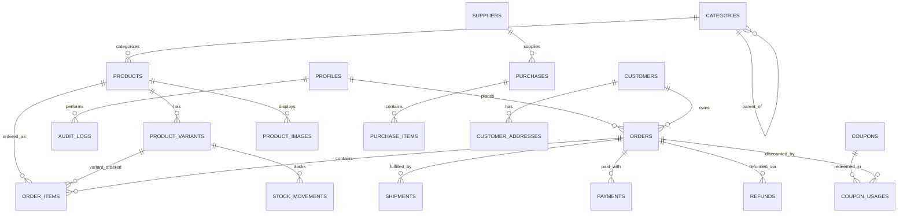

# ARONYOK (আরণ্যক) — Enterprise Database Specification & Architecture
**Database:** PostgreSQL 15+ (Hosted on Supabase)  
**Schema Name:** `public`  
**Migration Strategy:** Non-destructive, backward-compatible, version-controlled SQL migrations  
**Target Architecture:** Fully Normalized (3NF), ACID-compliant, RLS-enforced transactional relational database  

---

## 1. Existing vs. Target Schema Comparison

### 1.1 Existing Prototype Tables (Current State)
* `profiles` (basic role flag `admin` vs `customer`)
* `products` (loose category string, un-normalized single image, no variants, no botanical attributes, no cost price)
* `blog_posts` (basic blog posts)
* `dynamic_pages` (basic dynamic content pages)
* `tools` (eco tool configurations)
* `settings` (site title, OpenRouter system prompt, contact information)
* `orders` (monolithic order header with basic customer info)
* `order_items` (basic items list without variant foreign keys or cost prices)

### 1.2 Enterprise Schema Expansions (Target State)
1. **Catalog & Botanical Architecture:**
   * `categories`: Hierarchical category tree with slug, parent_id, icon, banner, and sort order.
   * `products`: Normalized product entity with SKU, brand, category_id, cost_price, botanical specifications (scientific_name, plant_type, light_requirement, watering_schedule, mature_height, pot_size, seasonal_timing).
   * `product_variants`: Support for plant heights, pot materials, honey jar sizes, and pack quantities with independent SKUs, prices, barcodes, and stock levels.
   * `product_images`: Multi-image galleries with order index, alt text, and variant associations.
2. **Inventory & Warehouse Tracking:**
   * `stock_movements`: Immutable double-entry ledger tracking every unit added (purchase), deducted (order), adjusted (damage/shrinkage), or returned.
3. **Procurement & Supply Chain:**
   * `suppliers`: Supplier directory with contact details, lead times, and payment terms.
   * `purchases`: Purchase orders (PO) with supplier_id, total_cost, invoice_reference, and status.
   * `purchase_items`: Line items received with unit cost and expiration/harvest dates.
4. **Customer Relationship Management (CRM):**
   * `customers`: Unified customer directory tracking total orders, lifetime value (LTV), tags (`VIP`, `Wholesale`, `Risk`), and notes.
   * `customer_addresses`: Multiple delivery addresses per customer with Division, District, Thana/Upazila, and default flags.
   * `leads`: Pre-order requests, WhatsApp inquiries, plant care requests, and follow-up reminders.
5. **Fulfillment, Logistics & Courier APIs:**
   * `shipments`: Courier assignments, consignment IDs, tracking numbers, dispatch dates, delivery fees, and courier webhook logs (Steadfast, Pathao, RedX).
   * `payments`: Payment gateway transaction logs, gateway reference IDs, MFS numbers, transaction fee deductions, and verification status.
   * `refunds`: Return reasons, damaged plant photo URLs, refund transaction IDs, and approved amounts.
6. **Marketing, Promotions & Governance:**
   * `coupons`: Promo codes, discount types (`percentage`, `fixed`), minimum order value, start/end dates, and maximum usage caps.
   * `coupon_usages`: Tracking customer coupon redemptions to prevent abuse.
   * `audit_logs`: Immutable security audit trail recording user_id, action, entity, entity_id, and JSON diffs.
   * `marketing_events`: Server-side CAPI event log with deduplication keys (`event_id`) and matching status.

---

## 2. Complete Entity-Relationship Diagram (ERD)



---

## 3. Detailed Data Definition Language (DDL) Specification

### 3.1 Extensions & Custom Types
```sql
CREATE EXTENSION IF NOT EXISTS "uuid-ossp";
CREATE EXTENSION IF NOT EXISTS "citext";

-- Custom Enum Types
DO $$ BEGIN
  CREATE TYPE user_role_enum AS ENUM ('super_admin', 'store_manager', 'fulfillment_agent', 'customer');
  CREATE TYPE order_status_enum AS ENUM ('pending', 'confirmed', 'processing', 'shipped', 'delivered', 'cancelled', 'returned');
  CREATE TYPE payment_status_enum AS ENUM ('pending', 'authorized', 'paid', 'failed', 'refunded');
  CREATE TYPE payment_method_enum AS ENUM ('cod', 'bkash', 'nagad', 'sslcommerz', 'stripe');
  CREATE TYPE stock_movement_enum AS ENUM ('sale', 'restock', 'return', 'damage', 'adjustment');
  CREATE TYPE discount_type_enum AS ENUM ('percentage', 'fixed_amount', 'free_shipping');
EXCEPTION
  WHEN duplicate_object THEN null;
END $$;
```

### 3.2 Profiles & Identity Table
```sql
CREATE TABLE IF NOT EXISTS public.profiles (
  id uuid PRIMARY KEY REFERENCES auth.users(id) ON DELETE CASCADE,
  role user_role_enum NOT NULL DEFAULT 'customer',
  full_name text NOT NULL DEFAULT '',
  email citext NOT NULL UNIQUE,
  phone text,
  avatar_url text,
  is_active boolean NOT NULL DEFAULT true,
  created_at timestamptz NOT NULL DEFAULT timezone('utc'::text, now()),
  updated_at timestamptz NOT NULL DEFAULT timezone('utc'::text, now())
);

CREATE INDEX IF NOT EXISTS idx_profiles_email ON public.profiles(email);
CREATE INDEX IF NOT EXISTS idx_profiles_role ON public.profiles(role);
```

### 3.3 Categories & Collections Table
```sql
CREATE TABLE IF NOT EXISTS public.categories (
  id uuid PRIMARY KEY DEFAULT gen_random_uuid(),
  parent_id uuid REFERENCES public.categories(id) ON DELETE SET NULL,
  slug text NOT NULL UNIQUE,
  name jsonb NOT NULL, -- {"en": "Fruit Plants", "bn": "ফলজ গাছ"}
  description jsonb DEFAULT '{"en": "", "bn": ""}'::jsonb,
  image_url text,
  icon_name text DEFAULT 'Leaf',
  display_order integer NOT NULL DEFAULT 0,
  is_active boolean NOT NULL DEFAULT true,
  created_at timestamptz NOT NULL DEFAULT timezone('utc'::text, now()),
  updated_at timestamptz NOT NULL DEFAULT timezone('utc'::text, now())
);

CREATE INDEX IF NOT EXISTS idx_categories_slug ON public.categories(slug);
CREATE INDEX IF NOT EXISTS idx_categories_parent ON public.categories(parent_id);
```

### 3.4 Enhanced Products Table
```sql
CREATE TABLE IF NOT EXISTS public.products (
  id uuid PRIMARY KEY DEFAULT gen_random_uuid(),
  category_id uuid REFERENCES public.categories(id) ON DELETE SET NULL,
  sku text UNIQUE,
  name jsonb NOT NULL, -- {"en": "Cinnamon Plant", "bn": "দারুচিনি গাছ"}
  slug text NOT NULL UNIQUE,
  description jsonb NOT NULL,
  price numeric(10,2) NOT NULL CHECK (price >= 0),
  compare_at_price numeric(10,2) CHECK (compare_at_price >= price OR compare_at_price IS NULL),
  cost_price numeric(10,2) DEFAULT 0 CHECK (cost_price >= 0),
  stock integer NOT NULL DEFAULT 0 CHECK (stock >= 0),
  low_stock_threshold integer NOT NULL DEFAULT 5,
  image_url text NOT NULL,
  is_active boolean NOT NULL DEFAULT true,
  is_featured boolean NOT NULL DEFAULT false,
  
  -- Specialized Botanical Attributes
  scientific_name text, -- e.g., 'Cinnamomum verum'
  variety text,         -- e.g., 'Ceylon Sweet'
  propagation_method text, -- 'grafted', 'seedling', 'cutting'
  plant_age text,       -- '1.5 Years'
  mature_height text,   -- '15-20 Feet'
  pot_size text,        -- '12 Inch Clay Pot'
  sunlight_requirement text, -- 'full_sun', 'partial_shade', 'indoor'
  watering_schedule text,    -- 'daily', 'alternate_days', 'weekly'
  seasonal_availability text, -- 'all_season', 'summer', 'monsoon', 'winter'
  is_pet_friendly boolean DEFAULT true,
  
  -- SEO & Metadata
  seo_title jsonb DEFAULT '{"en": "", "bn": ""}'::jsonb,
  seo_description jsonb DEFAULT '{"en": "", "bn": ""}'::jsonb,
  
  created_at timestamptz NOT NULL DEFAULT timezone('utc'::text, now()),
  updated_at timestamptz NOT NULL DEFAULT timezone('utc'::text, now())
);

CREATE INDEX IF NOT EXISTS idx_products_slug ON public.products(slug);
CREATE INDEX IF NOT EXISTS idx_products_category ON public.products(category_id);
CREATE INDEX IF NOT EXISTS idx_products_is_active ON public.products(is_active);
CREATE INDEX IF NOT EXISTS idx_products_is_featured ON public.products(is_featured);
```

### 3.5 Product Variants & Image Gallery
```sql
CREATE TABLE IF NOT EXISTS public.product_variants (
  id uuid PRIMARY KEY DEFAULT gen_random_uuid(),
  product_id uuid NOT NULL REFERENCES public.products(id) ON DELETE CASCADE,
  sku text NOT NULL UNIQUE,
  title jsonb NOT NULL, -- {"en": "10-inch Pot", "bn": "১০ ইঞ্চি টব"}
  price numeric(10,2) NOT NULL CHECK (price >= 0),
  compare_at_price numeric(10,2),
  cost_price numeric(10,2) DEFAULT 0,
  stock integer NOT NULL DEFAULT 0 CHECK (stock >= 0),
  image_url text,
  is_active boolean NOT NULL DEFAULT true,
  created_at timestamptz NOT NULL DEFAULT timezone('utc'::text, now())
);

CREATE INDEX IF NOT EXISTS idx_product_variants_product ON public.product_variants(product_id);

CREATE TABLE IF NOT EXISTS public.product_images (
  id uuid PRIMARY KEY DEFAULT gen_random_uuid(),
  product_id uuid NOT NULL REFERENCES public.products(id) ON DELETE CASCADE,
  image_url text NOT NULL,
  alt_text jsonb DEFAULT '{"en": "", "bn": ""}'::jsonb,
  display_order integer NOT NULL DEFAULT 0,
  created_at timestamptz NOT NULL DEFAULT timezone('utc'::text, now())
);

CREATE INDEX IF NOT EXISTS idx_product_images_product ON public.product_images(product_id, display_order);
```

### 3.6 Customers & Addresses (CRM)
```sql
CREATE TABLE IF NOT EXISTS public.customers (
  id uuid PRIMARY KEY DEFAULT gen_random_uuid(),
  profile_id uuid REFERENCES public.profiles(id) ON DELETE SET NULL,
  full_name text NOT NULL,
  phone text NOT NULL UNIQUE,
  email citext,
  total_orders integer NOT NULL DEFAULT 0,
  total_spent numeric(12,2) NOT NULL DEFAULT 0,
  customer_tags text[] DEFAULT '{}'::text[],
  notes text,
  created_at timestamptz NOT NULL DEFAULT timezone('utc'::text, now()),
  updated_at timestamptz NOT NULL DEFAULT timezone('utc'::text, now())
);

CREATE INDEX IF NOT EXISTS idx_customers_phone ON public.customers(phone);
CREATE INDEX IF NOT EXISTS idx_customers_email ON public.customers(email);

CREATE TABLE IF NOT EXISTS public.customer_addresses (
  id uuid PRIMARY KEY DEFAULT gen_random_uuid(),
  customer_id uuid NOT NULL REFERENCES public.customers(id) ON DELETE CASCADE,
  division text NOT NULL,
  district text NOT NULL,
  thana text NOT NULL,
  street_address text NOT NULL,
  landmark text,
  is_default boolean NOT NULL DEFAULT false,
  created_at timestamptz NOT NULL DEFAULT timezone('utc'::text, now())
);

CREATE INDEX IF NOT EXISTS idx_customer_addresses_customer ON public.customer_addresses(customer_id);
```

### 3.7 Transactional Orders, Items & Shipments
```sql
CREATE TABLE IF NOT EXISTS public.orders (
  id uuid PRIMARY KEY DEFAULT gen_random_uuid(),
  order_number text NOT NULL UNIQUE,
  customer_id uuid REFERENCES public.customers(id) ON DELETE SET NULL,
  customer_name text NOT NULL,
  customer_email citext,
  customer_phone text NOT NULL,
  shipping_address text NOT NULL,
  city text NOT NULL, -- District
  thana text,
  postal_code text,
  
  subtotal numeric(10,2) NOT NULL CHECK (subtotal >= 0),
  delivery_charge numeric(10,2) NOT NULL DEFAULT 0 CHECK (delivery_charge >= 0),
  discount_amount numeric(10,2) NOT NULL DEFAULT 0 CHECK (discount_amount >= 0),
  total_amount numeric(10,2) NOT NULL CHECK (total_amount >= 0),
  
  payment_method payment_method_enum NOT NULL DEFAULT 'cod',
  payment_status payment_status_enum NOT NULL DEFAULT 'pending',
  order_status order_status_enum NOT NULL DEFAULT 'pending',
  
  coupon_code text,
  payment_reference text,
  customer_notes text,
  admin_notes text,
  is_archived boolean NOT NULL DEFAULT false,
  
  created_at timestamptz NOT NULL DEFAULT timezone('utc'::text, now()),
  updated_at timestamptz NOT NULL DEFAULT timezone('utc'::text, now())
);

CREATE INDEX IF NOT EXISTS idx_orders_number ON public.orders(order_number);
CREATE INDEX IF NOT EXISTS idx_orders_customer_phone ON public.orders(customer_phone);
CREATE INDEX IF NOT EXISTS idx_orders_status ON public.orders(order_status);
CREATE INDEX IF NOT EXISTS idx_orders_created_at ON public.orders(created_at DESC);

CREATE TABLE IF NOT EXISTS public.order_items (
  id uuid PRIMARY KEY DEFAULT gen_random_uuid(),
  order_id uuid NOT NULL REFERENCES public.orders(id) ON DELETE CASCADE,
  product_id uuid REFERENCES public.products(id) ON DELETE SET NULL,
  variant_id uuid REFERENCES public.product_variants(id) ON DELETE SET NULL,
  product_name text NOT NULL,
  unit_price numeric(10,2) NOT NULL CHECK (unit_price >= 0),
  unit_cost numeric(10,2) DEFAULT 0,
  quantity integer NOT NULL CHECK (quantity > 0),
  total_price numeric(10,2) NOT NULL CHECK (total_price >= 0)
);

CREATE INDEX IF NOT EXISTS idx_order_items_order ON public.order_items(order_id);
CREATE INDEX IF NOT EXISTS idx_order_items_product ON public.order_items(product_id);

CREATE TABLE IF NOT EXISTS public.shipments (
  id uuid PRIMARY KEY DEFAULT gen_random_uuid(),
  order_id uuid NOT NULL REFERENCES public.orders(id) ON DELETE CASCADE,
  courier_partner text NOT NULL, -- 'steadfast', 'pathao', 'redx', 'self_delivery'
  consignment_id text,
  tracking_code text,
  tracking_url text,
  courier_status text NOT NULL DEFAULT 'manifested',
  courier_charge numeric(10,2) DEFAULT 0,
  dispatched_at timestamptz,
  delivered_at timestamptz,
  created_at timestamptz NOT NULL DEFAULT timezone('utc'::text, now())
);

CREATE INDEX IF NOT EXISTS idx_shipments_order ON public.shipments(order_id);
CREATE INDEX IF NOT EXISTS idx_shipments_tracking ON public.shipments(tracking_code);
```

### 3.8 Stock Movements & Inventory Auditing
```sql
CREATE TABLE IF NOT EXISTS public.stock_movements (
  id uuid PRIMARY KEY DEFAULT gen_random_uuid(),
  product_id uuid NOT NULL REFERENCES public.products(id) ON DELETE CASCADE,
  variant_id uuid REFERENCES public.product_variants(id) ON DELETE SET NULL,
  movement_type stock_movement_enum NOT NULL,
  quantity_change integer NOT NULL, -- positive for restock/returns, negative for sales/damages
  resulting_stock integer NOT NULL,
  reference_order_id uuid REFERENCES public.orders(id) ON DELETE SET NULL,
  notes text,
  created_by uuid REFERENCES public.profiles(id) ON DELETE SET NULL,
  created_at timestamptz NOT NULL DEFAULT timezone('utc'::text, now())
);

CREATE INDEX IF NOT EXISTS idx_stock_movements_product ON public.stock_movements(product_id);
CREATE INDEX IF NOT EXISTS idx_stock_movements_created ON public.stock_movements(created_at DESC);
```

### 3.9 Suppliers & Purchase Orders
```sql
CREATE TABLE IF NOT EXISTS public.suppliers (
  id uuid PRIMARY KEY DEFAULT gen_random_uuid(),
  company_name text NOT NULL,
  contact_person text,
  phone text NOT NULL,
  email citext,
  address text,
  supply_categories text[] DEFAULT '{}'::text[],
  is_active boolean NOT NULL DEFAULT true,
  created_at timestamptz NOT NULL DEFAULT timezone('utc'::text, now())
);

CREATE TABLE IF NOT EXISTS public.purchases (
  id uuid PRIMARY KEY DEFAULT gen_random_uuid(),
  po_number text NOT NULL UNIQUE,
  supplier_id uuid REFERENCES public.suppliers(id) ON DELETE SET NULL,
  total_cost numeric(12,2) NOT NULL CHECK (total_cost >= 0),
  status text NOT NULL DEFAULT 'received' CHECK (status IN ('ordered', 'received', 'cancelled')),
  invoice_reference text,
  received_date date DEFAULT CURRENT_DATE,
  notes text,
  created_at timestamptz NOT NULL DEFAULT timezone('utc'::text, now())
);

CREATE TABLE IF NOT EXISTS public.purchase_items (
  id uuid PRIMARY KEY DEFAULT gen_random_uuid(),
  purchase_id uuid NOT NULL REFERENCES public.purchases(id) ON DELETE CASCADE,
  product_id uuid NOT NULL REFERENCES public.products(id) ON DELETE RESTRICT,
  variant_id uuid REFERENCES public.product_variants(id) ON DELETE SET NULL,
  quantity integer NOT NULL CHECK (quantity > 0),
  unit_cost numeric(10,2) NOT NULL CHECK (unit_cost >= 0),
  total_cost numeric(10,2) NOT NULL CHECK (total_cost >= 0)
);
```

### 3.10 Marketing, Coupons & Analytics Events
```sql
CREATE TABLE IF NOT EXISTS public.coupons (
  id uuid PRIMARY KEY DEFAULT gen_random_uuid(),
  code text NOT NULL UNIQUE,
  discount_type discount_type_enum NOT NULL DEFAULT 'percentage',
  discount_value numeric(10,2) NOT NULL CHECK (discount_value > 0),
  min_order_value numeric(10,2) NOT NULL DEFAULT 0,
  max_discount_amount numeric(10,2),
  start_date timestamptz NOT NULL DEFAULT timezone('utc'::text, now()),
  end_date timestamptz,
  usage_limit integer,
  usage_count integer NOT NULL DEFAULT 0,
  is_active boolean NOT NULL DEFAULT true,
  created_at timestamptz NOT NULL DEFAULT timezone('utc'::text, now())
);

CREATE TABLE IF NOT EXISTS public.coupon_usages (
  id uuid PRIMARY KEY DEFAULT gen_random_uuid(),
  coupon_id uuid NOT NULL REFERENCES public.coupons(id) ON DELETE CASCADE,
  order_id uuid NOT NULL REFERENCES public.orders(id) ON DELETE CASCADE,
  customer_id uuid REFERENCES public.customers(id) ON DELETE SET NULL,
  discount_applied numeric(10,2) NOT NULL,
  created_at timestamptz NOT NULL DEFAULT timezone('utc'::text, now())
);

CREATE TABLE IF NOT EXISTS public.marketing_events (
  id uuid PRIMARY KEY DEFAULT gen_random_uuid(),
  event_name text NOT NULL,
  event_id text NOT NULL UNIQUE, -- For Meta Pixel & CAPI deduplication
  source text NOT NULL DEFAULT 'server_capi',
  user_email_hash text,
  user_phone_hash text,
  custom_data jsonb DEFAULT '{}'::jsonb,
  status text NOT NULL DEFAULT 'dispatched',
  created_at timestamptz NOT NULL DEFAULT timezone('utc'::text, now())
);

CREATE INDEX IF NOT EXISTS idx_marketing_events_event_id ON public.marketing_events(event_id);
```

### 3.11 Immutable Audit Logging
```sql
CREATE TABLE IF NOT EXISTS public.audit_logs (
  id uuid PRIMARY KEY DEFAULT gen_random_uuid(),
  user_id uuid REFERENCES public.profiles(id) ON DELETE SET NULL,
  user_email text,
  action text NOT NULL, -- e.g., 'UPDATE_PRICE', 'CANCEL_ORDER', 'CHANGE_IMAGE'
  entity text NOT NULL, -- e.g., 'products', 'orders', 'settings'
  entity_id text,
  diff jsonb,
  ip_address text,
  created_at timestamptz NOT NULL DEFAULT timezone('utc'::text, now())
);

CREATE INDEX IF NOT EXISTS idx_audit_logs_created ON public.audit_logs(created_at DESC);
CREATE INDEX IF NOT EXISTS idx_audit_logs_entity ON public.audit_logs(entity, entity_id);
```

---

## 4. Row Level Security (RLS) Policy Blueprint

Every table must have RLS strictly enabled. Public roles (`anon`) must only have read access to active catalog items and insert access to order headers with zero select access to other customers' orders.

```sql
-- Helper function checking admin privilege
CREATE OR REPLACE FUNCTION public.is_staff()
RETURNS boolean AS $$
BEGIN
  RETURN EXISTS (
    SELECT 1 FROM public.profiles
    WHERE id = auth.uid() AND role IN ('super_admin', 'store_manager', 'fulfillment_agent')
  );
END;
$$ LANGUAGE plpgsql SECURITY DEFINER;

-- Enable RLS across all tables
ALTER TABLE public.profiles ENABLE ROW LEVEL SECURITY;
ALTER TABLE public.categories ENABLE ROW LEVEL SECURITY;
ALTER TABLE public.products ENABLE ROW LEVEL SECURITY;
ALTER TABLE public.product_variants ENABLE ROW LEVEL SECURITY;
ALTER TABLE public.product_images ENABLE ROW LEVEL SECURITY;
ALTER TABLE public.customers ENABLE ROW LEVEL SECURITY;
ALTER TABLE public.customer_addresses ENABLE ROW LEVEL SECURITY;
ALTER TABLE public.orders ENABLE ROW LEVEL SECURITY;
ALTER TABLE public.order_items ENABLE ROW LEVEL SECURITY;
ALTER TABLE public.shipments ENABLE ROW LEVEL SECURITY;
ALTER TABLE public.stock_movements ENABLE ROW LEVEL SECURITY;
ALTER TABLE public.suppliers ENABLE ROW LEVEL SECURITY;
ALTER TABLE public.purchases ENABLE ROW LEVEL SECURITY;
ALTER TABLE public.purchase_items ENABLE ROW LEVEL SECURITY;
ALTER TABLE public.coupons ENABLE ROW LEVEL SECURITY;
ALTER TABLE public.coupon_usages ENABLE ROW LEVEL SECURITY;
ALTER TABLE public.audit_logs ENABLE ROW LEVEL SECURITY;
ALTER TABLE public.marketing_events ENABLE ROW LEVEL SECURITY;

-- Product Policies: Public reads active products; Staff manages all
CREATE POLICY "Public reads active products" ON public.products FOR SELECT USING (is_active = true OR public.is_staff());
CREATE POLICY "Staff manages products" ON public.products FOR ALL USING (public.is_staff());

-- Order Policies: Customers read only their own orders; Staff reads all
CREATE POLICY "Staff manages all orders" ON public.orders FOR ALL USING (public.is_staff());
CREATE POLICY "Public can insert orders" ON public.orders FOR INSERT WITH CHECK (true);
CREATE POLICY "Customers view own orders" ON public.orders FOR SELECT USING (
  customer_id IN (SELECT id FROM public.customers WHERE profile_id = auth.uid())
);
```

---

## 5. Transactional Inventory Reservation & Deduplication Function

To eliminate race conditions and overselling during simultaneous checkouts, a PostgreSQL stored procedure executes the order creation and stock decrement in an atomic transaction:

```sql
CREATE OR REPLACE FUNCTION public.process_checkout_transaction(
  p_order_number text,
  p_customer_name text,
  p_customer_phone text,
  p_customer_email text,
  p_shipping_address text,
  p_city text,
  p_thana text,
  p_payment_method text,
  p_customer_notes text,
  p_delivery_charge numeric,
  p_items jsonb -- array of objects: [{"product_id": "...", "quantity": 2}]
)
RETURNS jsonb AS $$
DECLARE
  v_order_id uuid;
  v_item record;
  v_product record;
  v_calculated_subtotal numeric := 0;
  v_calculated_total numeric := 0;
  v_line_total numeric := 0;
BEGIN
  -- 1. Validate and lock product rows for atomic stock update
  FOR v_item IN SELECT * FROM jsonb_to_recordset(p_items) AS x(product_id uuid, quantity int)
  LOOP
    SELECT id, price, stock, is_active, name INTO v_product
    FROM public.products
    WHERE id = v_item.product_id
    FOR UPDATE; -- Row-level lock prevents race conditions
    
    IF NOT FOUND THEN
      RAISE EXCEPTION 'Product % does not exist', v_item.product_id;
    END IF;
    
    IF NOT v_product.is_active THEN
      RAISE EXCEPTION 'Product % is inactive', v_product.name->>'en';
    END IF;
    
    IF v_product.stock < v_item.quantity THEN
      RAISE EXCEPTION 'Insufficient stock for product % (Available: %, Requested: %)', 
        v_product.name->>'en', v_product.stock, v_item.quantity;
    END IF;
    
    v_line_total := v_product.price * v_item.quantity;
    v_calculated_subtotal := v_calculated_subtotal + v_line_total;
  END LOOP;

  v_calculated_total := v_calculated_subtotal + p_delivery_charge;

  -- 2. Insert Order Header
  INSERT INTO public.orders (
    order_number, customer_name, customer_phone, customer_email,
    shipping_address, city, thana, payment_method, payment_status,
    order_status, subtotal, delivery_charge, total_amount, customer_notes
  ) VALUES (
    p_order_number, p_customer_name, p_customer_phone, p_customer_email,
    p_shipping_address, p_city, p_thana, p_payment_method::payment_method_enum,
    'pending', 'pending', v_calculated_subtotal, p_delivery_charge, v_calculated_total, p_customer_notes
  ) RETURNING id INTO v_order_id;

  -- 3. Insert Order Items & Deduct Stock Atomically
  FOR v_item IN SELECT * FROM jsonb_to_recordset(p_items) AS x(product_id uuid, quantity int)
  LOOP
    SELECT price, name, stock INTO v_product FROM public.products WHERE id = v_item.product_id;
    v_line_total := v_product.price * v_item.quantity;
    
    INSERT INTO public.order_items (
      order_id, product_id, product_name, unit_price, quantity, total_price
    ) VALUES (
      v_order_id, v_item.product_id, v_product.name->>'en', v_product.price, v_item.quantity, v_line_total
    );
    
    -- Decrement product stock
    UPDATE public.products
    SET stock = stock - v_item.quantity,
        updated_at = timezone('utc'::text, now())
    WHERE id = v_item.product_id;
    
    -- Record immutable stock movement
    INSERT INTO public.stock_movements (
      product_id, movement_type, quantity_change, resulting_stock, reference_order_id, notes
    ) VALUES (
      v_item.product_id, 'sale', -v_item.quantity, v_product.stock - v_item.quantity, v_order_id, 'Customer checkout order ' || p_order_number
    );
  END LOOP;

  RETURN jsonb_build_object(
    'success', true,
    'order_id', v_order_id,
    'order_number', p_order_number,
    'total_amount', v_calculated_total
  );
END;
$$ LANGUAGE plpgsql SECURITY DEFINER;
```
