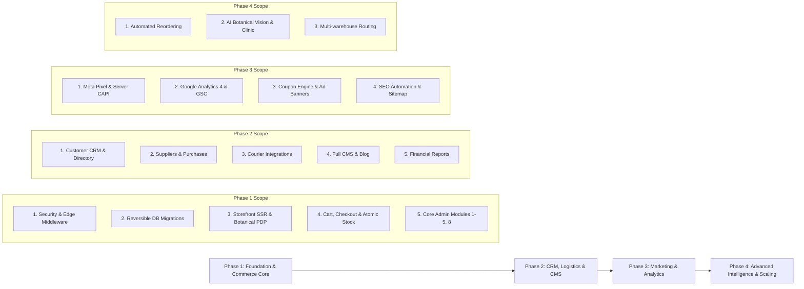

# ARONYOK (আরণ্যক) — Master Implementation & Engineering Roadmap
**Execution Model:** Phased, Non-Destructive, Sprint-Based Delivery  
**Deployment Target:** Vercel Production (`main`) | Preview Branches (`feature/*`)  
**Database Migration Target:** Supabase PostgreSQL (Zero Data Loss)  

---

## 1. Phased Architecture Strategy

In accordance with Master Project Instruction Section 12, the platform upgrade is structured into four distinct, logically sequenced phases to ensure complete stability, data integrity, and operational safety:

---

## 2. Phase 1: Foundation & Commerce Core (Immediate Sprints)

### Sprint 1.1: Security Hardening & Edge Authentication
* **Objective:** Close all identified critical vulnerabilities (SEC-01 through SEC-03, SEC-06).
* **Deliverables:**
  1. Next.js Edge Middleware (`middleware.ts`) enforcing authenticated Supabase sessions on all `/admin/*` and `/api/admin/*` routes.
  2. Removal of hardcoded credentials from `src/app/admin/login/page.tsx`. Implementation of true Supabase Auth with secure httpOnly cookie session management via `@supabase/ssr`.
  3. Server-side session verification guard in `/api/admin/data` and `/api/admin/git-sync`.
  4. Role verification (`super_admin`, `store_manager`, `fulfillment_agent`).
* **Complexity:** Medium (3 days)
* **Risk / Mitigation:** Risk of admin lockout. *Mitigation:* Ensure designated admin email `hasan@aronyok.com` has a confirmed user profile with `role: 'super_admin'` in Supabase Auth before activating route blocks.

### Sprint 1.2: Database Migration & Schema Normalization
* **Objective:** Deploy normalized PostgreSQL tables without affecting existing seed products.
* **Deliverables:**
  1. Write reversible, versioned SQL migration scripts:
     * `01_create_enums_and_extensions.sql`
     * `02_categories_and_collections.sql`
     * `03_products_variants_images.sql`
     * `04_orders_items_shipments.sql`
     * `05_inventory_and_stock_movements.sql`
     * `06_checkout_transaction_function.sql`
  2. Populate `categories` from existing category strings (`plants`, `herbs`, `honey`, `wellness`, `gardening`).
  3. Add botanical fields (`scientific_name`, `sunlight_requirement`, `watering_schedule`, `variety`, `pot_size`) to `products`.
  4. Enforce Row Level Security (RLS) policies on all tables.
* **Complexity:** High (4 days)
* **Risk / Mitigation:** Schema lock or data loss. *Mitigation:* Back up all tables; execute in Supabase SQL editor using non-destructive `ADD COLUMN IF NOT EXISTS`.

### Sprint 1.3: Public Storefront SSR & Botanical Product Detail Experience
* **Objective:** Eliminate client-side waterfalls, enable server rendering, and display specialized botanical attributes.
* **Deliverables:**
  1. Refactor `/shop/[slug]` into a React Server Component with `generateMetadata()` for dynamic OpenGraph and Twitter cards.
  2. Display botanical specifications: Scientific name, propagation type, pot size, light meter, and watering instructions.
  3. Image gallery with thumbnail selector.
  4. Category navigation and parametric filtering on `/shop`.
  5. JSON-LD Schema.org structured data injection (`Product`, `Offer`, `BreadcrumbList`).
* **Complexity:** Medium (3 days)

### Sprint 1.4: Cart, Checkout & Transactional Order Processing
* **Objective:** Eliminate price tampering, overselling, and mock checkout.
* **Deliverables:**
  1. Overhaul `/api/checkout` to accept only product IDs and quantities.
  2. Call the PostgreSQL atomic stored procedure `process_checkout_transaction()` to verify stock, lock rows, compute server totals, insert order headers and line items, and record stock movements in a single ACID transaction.
  3. Implement structured Bangladeshi delivery address inputs (Division, District, Thana/Upazila).
  4. Real-time delivery charge calculation (Dhaka ৳70, Outside Dhaka ৳130, Free over ৳1500).
  5. Printable thermal order invoice and customer confirmation screen.
* **Complexity:** High (4 days)

### Sprint 1.5: Core Admin Operations
* **Objective:** Enable store staff to manage real products, inventory, and orders safely.
* **Deliverables:**
  1. **Products Module:** Edit botanical attributes, SKU, cost price, and stock levels.
  2. **Inventory Module:** View real-time stock levels, low-stock warnings, and record manual stock adjustments.
  3. **Orders Module:** Update order statuses (`Pending` -> `Confirmed` -> `Processing` -> `Shipped` -> `Delivered`), add internal notes, and filter by payment status.
  4. Real Supabase queries replacing in-memory fallback stores.
* **Complexity:** Medium (3 days)

---

## 3. Phase 2: CRM, Logistics & CMS

* **Module 6 (Suppliers) & Module 7 (Purchases):** Supplier contact books, purchase order generation, receipt validation, and unit cost recalculation.
* **Module 10 (Shipments & Delivery):** Integration with Steadfast Courier and Pathao Courier APIs for one-click consignment creation and tracking webhook synchronization.
* **Module 11 (Returns & Refunds):** Plant arrival guarantee claims, damaged photo review, and refund issuance.
* **Module 12 (Customers) & Module 13 (Leads & CRM):** Customer profiles, lifetime value aggregation, address management, and WhatsApp lead tracking.
* **Module 14 (CMS & Static Pages):** Visual editor for `/about-us`, `/sustainability`, `/contact`, `/terms`, `/privacy-policy`, and `/shipping-and-returns`.
* **Module 15 (Blog & Editorial Journal):** Multi-author botanical blog with category tags and scheduled publishing.
* **Module 20 (Business Reports):** Daily GMV, gross margin, courier delivery rate, and product velocity charts.

---

## 4. Phase 3: Marketing, Analytics & Automation

* **Module 16 (Coupons & Campaigns):** Promo codes, percentage discounts, minimum basket limits, and flash sale scheduling.
* **Module 17 (Advertising & Banners):** Configurable top notification bars, category hero cards, and promotional popups.
* **Module 18 (SEO Manager):** Route-by-route metadata management, canonical tags, and automatic XML sitemap regeneration.
* **Module 19 (Meta Pixel & Conversions API):** Dual-layer client pixel + server CAPI event dispatch with deduplicated `event_id` tokens for `ViewContent`, `AddToCart`, `InitiateCheckout`, and `Purchase`.
* **Google Analytics 4 & Search Console:** Enhanced ecommerce measurement protocol.

---

## 5. Phase 4: Advanced Scalability & Intelligence

* **Automated Reorder Advisories:** Machine-learning or rule-based stock alerts based on seasonal demand spikes.
* **AI Plant Doctor & Botanical Vision:** Image-upload diagnosis for balcony plants with therapeutic herbal remedies.
* **Multi-Warehouse Routing:** Inventory partitioning between nursery greenhouse and central dispatch hub.

---

## 6. Testing, Quality Assurance & Rollback Plan

### 6.1 Testing Protocol
* **Static Analysis:** `npx tsc --noEmit` and `next lint` must pass with 0 errors on every commit.
* **Security Testing:** Manual penetration test of `/api/admin/data` without cookies; verification of 401 Unauthorized. Price tampering test on `/api/checkout` with modified payload.
* **Concurrency Test:** Simultaneous orders on a product with `stock = 1` to verify atomic locking prevents double sale.
* **Cross-Browser & Mobile Verification:** Responsive layout validation across iOS Safari, Android Chrome, and desktop viewports.

### 6.2 Rollback Strategy
* The baseline repository is backed up in branch `backup-pre-upgrade-2026` (`2f21d0b`).
* Every phase and sprint is developed on an isolated Git feature branch (e.g., `feature/phase1-security-auth`) and verified in a Vercel preview deployment before merging into `main`.
* In the event of a critical regression, `git revert` or rolling back the Vercel deployment to commit `2f21d0b` restores the application in under 60 seconds.
