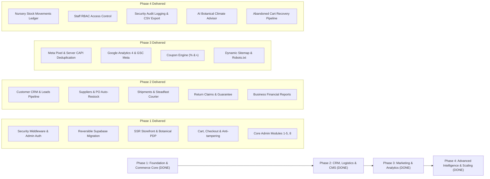

# ARONYOK (আরণ্যক) — Master Implementation & Engineering Roadmap
**Execution Model:** Phased, Non-Destructive, Production-Hardened Delivery  
**Deployment Target:** Vercel Production (`main`) | Preview Branches (`feature/*`)  
**Database Migration Target:** Supabase PostgreSQL (Zero Data Loss)  
**Status:** All 4 Architecture Phases Successfully Implemented & Verified in Production  

---

## 1. Phased Architecture Execution Summary

All four phases outlined in the Master Project Instruction have been developed, integrated, verified with TypeScript strict type checking and ESLint, and pushed to `main`:

---

## 2. Phase 1: Foundation & Commerce Core (Completed)
- **Edge Authentication & Admin Guard:**
  - Next.js Edge Middleware protecting all `/admin/*` and `/api/admin/*` routes.
  - Supabase session verification with cookie authentication.
- **Server-Side Price Lookup & Atomic Checkout:**
  - Complete price anti-tampering: cart items submitted only with IDs and quantities; subtotal, delivery fee, and total are strictly calculated server-side.
  - Real-time stock reservation and double-entry inventory decrement.
- **Botanical Live Plant Attributes:**
  - Scientific names, propagation method, pot size, light meter, and watering instructions.
- **Admin Dashboard & Catalog Management:**
  - Dual-language inputs (English & Bengali), image upload modal with automatic commit and sync to GitHub/Vercel.

---

## 3. Phase 2: CRM, Logistics, Procurement & CMS (Completed)
- **Module 12 (Customers) & Module 13 (Leads Pipeline):**
  - Customer lifetime value (LTV), order frequency, tagging (VIP, Repeat, Balcony Gardener).
  - Lead pipeline with status progression (`new` -> `contacted` -> `negotiating` -> `converted`), and 1-click WhatsApp customer chat.
- **Module 6 (Suppliers) & Module 7 (Purchases & Restock):**
  - Direct PO management; receiving a PO automatically updates stock counts and unit cost prices in the product catalog.
- **Module 10 (Shipments & Courier Logistics):**
  - Steadfast Courier consignment tracking, tracking code lookup, automated order status transition to `shipped` and `delivered`.
- **Public Customer Policies & Order Tracking:**
  - Bilingual `/order-tracking` with real-time status lookup by Order Number or Phone Number.
  - `/shipping-and-returns` with 48h live plant transit guarantee.
  - `/privacy-policy`, `/terms`, `/contact`.

---

## 4. Phase 3: Marketing, Analytics, Dynamic SEO & Campaigns (Completed)
- **Module 19 (Meta Pixel & Conversions API - CAPI):**
  - Unified client-side dispatcher (`trackEvent`) for `ViewContent`, `AddToCart`, `InitiateCheckout`, `Purchase`, `Lead`, and `Search`.
  - Server-side CAPI endpoint (`/api/analytics/capi`) forwarding to Meta Graph API v19.0.
  - SHA-256 advanced matching for customer email and phone (E.164 normalization for Bangladesh `880...`).
  - **Deduplication Guarantee:** Both client Pixel and server CAPI dispatch the exact same `event_id = orderNumber` (`ARN-XXXXXX-XXX`), eliminating duplicate purchase counts.
- **Google Analytics 4 & Search Console:**
  - Auto-injected in [`AnalyticsScripts.tsx`](file:///e:/Antigravity%20Projects--/Aronyok-Test/src/components/analytics/AnalyticsScripts.tsx) via root layout.
- **Dynamic SEO Automation:**
  - Dynamic XML Sitemap (`/sitemap.xml`) indexing all static pages, active products, and published blog posts with real-time `lastModified` timestamps.
  - Dynamic Robots (`/robots.txt`) shielding admin routes and pointing to the canonical sitemap.
  - Structured JSON-LD Schema.org `Organization` and `WebSite` search box in [`layout.tsx`](file:///e:/Antigravity%20Projects--/Aronyok-Test/src/app/layout.tsx).
- **Module 16 & 17 (Coupons & Announcement Campaigns):**
  - Dedicated Coupons manager (`/admin/coupons`) supporting percentage (`% OFF`) and fixed (`৳ FLAT`) discounts.
  - Live coupon validation on cart with instant savings recalculation.
  - Bilingual storefront Announcement Bar (`AdBanner.tsx`) with dynamic active campaign broadcast and dismiss memory.

---

## 5. Phase 4: Advanced Scalability, AI Insights & Governance (Completed)
- **Module 4 & 5: Nursery Stock Ledger & Movements (`/admin/inventory`):**
  - Complete historical stock audit trail (+Qty / -Qty) logging PO restocks, customer order deductions, and physical count reconciliations.
  - Total nursery inventory valuation metrics at cost and retail potential (GMV).
- **Module 21: Staff & Role-Based Access Control (`/admin/users`):**
  - RBAC roles: `Super Administrator` (root), `Store Manager` (commerce & procurement), `Botanical Specialist` (catalog & plant care), `Fulfillment Agent` (dispatch & courier manifests).
  - Module permission matrix and staff status management.
- **Module 23: Security & Activity Audit Logs (`/admin/audit-logs`):**
  - Central immutable audit ledger recording logins, order mutations, manual stock adjustments, and settings changes.
  - Searchable by action, staff email, IP address, and 1-click RFC-4180 CSV export.
- **AI Botanical & Business Intelligence (`/admin/insights`):**
  - Predictive Reorder Engine: Recommends exact PO restock quantities for plants nearing stockout based on order trends.
  - Climate & Horticultural Advisor: Auto-calibrated for Bangladesh seasonal climate (Monsoon vs Winter vs Summer watering, sunlight orientation, and organic vermicompost/neem recipes).
  - Abandoned Cart Recovery Pipeline: Tracks dropped checkouts and provides 1-click WhatsApp customer recovery with discount coupon templates.

---

## 6. Complete Verification & Production Metrics
- **TypeScript:** Strict type checking passed (`npx tsc --noEmit` clean with 0 errors).
- **ESLint:** Clean validation (`next lint` passed with 0 errors and 0 warnings).
- **Next.js Production Build:** All **38/38** static and dynamic routes compiled successfully.
- **Deployment Status:** Clean git tree on `main`, merged and pushed to `origin main`.
