# ARONYOK (আরণ্যক) — Product Requirements Document (PRD)
**Version:** 2.0 (Production Release)  
**Status:** Architecture Approved  
**Author:** Lead Software Architect  
**Brand:** ARONYOK (আরণ্যক) | *With Nature, Towards the Future*  
**Platform:** High-Performance Bilingual Nature & Botanical Ecommerce, Logistics & Business Management Platform  

---

## 1. Vision & Strategic Objective

**Aronyok (আরণ্যক)** is a digital-first, premium botanical and sustainable lifestyle brand based in Bangladesh. The platform bridges ancient herbal wisdom and modern botanical living by offering high-grade live plants, raw forest honey, cold-pressed therapeutic oils, handcrafted terracotta, and organic gardening solutions.

The objective of this engineering release is to transform Aronyok from a prototype storefront into a robust, high-volume, enterprise-grade business management and ecommerce platform that guarantees:
1. **Uncompromised Data & Transaction Security:** Zero vulnerabilities, robust Role-Based Access Control (RBAC), and server-side payment/order verification.
2. **Reliable Commercial Operations:** Accurate inventory reservations, automated stock tracking, barcode/SKU support, multi-courier dispatch, and customer CRM.
3. **Flawless Bilingual UX:** High-speed, responsive, editorial botanical design in both Bengali and English.
4. **Omnichannel Growth Readiness:** Deep integration with Meta Pixel & Conversions API (CAPI), Google Analytics 4, and automated search engine optimization.

---

## 2. Brand Identity & Visual Design Guidelines

### 2.1 Color Palette
* **Forest Green (`#234B36`):** Primary brand anchor representing lush native vegetation, deep forest canopy, authority, and organic authenticity.
* **Sage Green (`#9EAF91`):** Gentle secondary tone evoking tender herbal shoots, soothing botanical care, and balance.
* **Warm Cream (`#F5F1E7`):** Background foundation providing an organic, non-sterile canvas reminiscent of handmade recycled paper.
* **Earth Brown (`#8B684B`):** Warm tertiary accent echoing fertile Bengal riverbed soil and natural bark.
* **Terracotta (`#C47D5A`):** Vivid call-to-action color inspired by traditional Bengali clay pottery and artisanal craftsmanship.
* **Charcoal (`#292C27`):** High-contrast, soft-black text color ensuring WCAG AAA accessibility across light backgrounds.

### 2.2 Typography
* **Latin / English:** *DM Sans* or *Manrope* (clean geometric sans with organic character, optimized for micro-legibility and editorial headers).
* **Bengali (বাংলা):** *Hind Siliguri* or *Noto Sans Bengali* (crisp Bengali typography with native conjunct rendering, generous line-heights, and clear numeral glyphs).

### 2.3 Editorial Design Direction
* Generous whitespace and asymmetric editorial layouts.
* Organic card borders (`rounded-3xl` and `rounded-2xl`) and tactile micro-interactions.
* Authentic, unretouched botanical photography showcasing root systems, leaves, soil texture, and handcrafted packaging.
* Strict rejection of generic, template-driven ecommerce styling in favor of a boutique nature journal feel.

---

## 3. User Personas & Target Segments

1. **Urban Plant Parent (Tanvir, 29, Dhaka):** Balcony gardener looking for healthy, verified grafted fruit and ornamental plants with transparent care instructions and sturdy doorstep packaging.
2. **Organic Wellness Enthusiast (Nusrat, 38, Chittagong):** Family-focused consumer seeking chemical-free Sundarbans raw honey, pure black seed oil, and herbal teas.
3. **Corporate & Green Gifter (Rahim, 44, Corporate Admin):** Bulk buyer purchasing terrariums, desk succulents, and customized eco-hampers for events.
4. **Store Manager / Operations Admin (Admin Staff):** Internal user responsible for order verification, inventory auditing, courier booking, and supplier replenishments.

---

## 4. Public Storefront Functional Requirements

### 4.1 Multi-Lingual Architecture
* Toggle between English and Bengali with persistent user preference stored in cookies and localStorage.
* Complete localization of all UI elements, status badges, botanical guides, payment instructions, error messages, and legal policies.
* Bengali numeral support (`৳৭৫০` vs `BDT 750`) across carts, invoices, and product cards.

### 4.2 Product Discovery & Catalog
* **Categories & Collections:** Multi-level taxonomy (`Plants` -> `Fruit Trees`, `Medicinal Herbs`, `Indoor Plants`; `Wellness` -> `Raw Honey`, `Herbal Teas`, `Cold-Pressed Oils`).
* **Live Search & Auto-Suggest:** Real-time query matching across English and Bengali product titles, scientific names, and category tags.
* **Parametric Filtering:** Filter by Category, Price Range, In-Stock status, Plant Height, Light Requirement (Direct Sun, Indirect, Shade), and Pet-Friendliness.

### 4.3 Botanical Product Detail Page (PDP)
* **Server-Rendered Metadata (SSR):** High-speed server rendering with dynamic OpenGraph cards, Twitter preview cards, and Schema.org JSON-LD.
* **Image Gallery:** Multi-image gallery with zoom preview, seedling closeups, and packaging views.
* **Botanical Attributes:**
  * Scientific Name (e.g., *Syzygium cumini*, *Asparagus racemosus*)
  * Variety & Propagation Method (Grafted / কলম, Seedling / বীজ, Cutting)
  * Pot Size & Plant Maturity Age
  * Sunlight & Watering Guide (Sun, Partial Shade, Weekly Watering)
  * Seasonal Fruiting & Flowering timeline
* **Inventory & Stock Badge:** Real-time availability indicator (`In Stock`, `Only 3 Left`, `Seasonal Pre-Order`).
* **Cross-Selling & Recommendations:** "Frequently Bought Together" (e.g., Plant + Organic Potting Soil + Clay Planter).

### 4.4 Persistent Cart & Drawer
* Seamless side drawer cart accessible from any page.
* Free shipping progress indicator (e.g., "Add ৳350 more to unlock Free Delivery across Dhaka").
* Quantity increment/decrement with instant stock validation.

### 4.5 Checkout & Order Fulfillment Flow
* **Address Hierarchy:** Structured Bangladeshi delivery address input (Division, District, Thana/Upazila, Street Address, Landmark).
* **Dynamic Delivery Charge Engine:**
  * Inside Dhaka: Standard ৳70 (Free above ৳1500 threshold).
  * Outside Dhaka (Inter-district plant handling): ৳130 - ৳150 with special packaging surcharge.
* **Payment Gateways:**
  * **Cash on Delivery (COD):** Available for all standard products; optional confirmation deposit for delicate live trees.
  * **Mobile Financial Services (bKash & Nagad):** Direct merchant payment with automated transaction ID entry and verified webhook callback.
  * **Debit/Credit Cards & Internet Banking:** SSLCommerz / Stripe integration.
* **Coupon & Discount Engine:** Coupon code validation with minimum spend limits, expiration dates, and category restrictions.
* **Order Confirmation & Customer Tracking:** Clean order confirmation page with printable summary and instant SMS/Email notification scaffolding.

### 4.6 Customer Portal & Guest Tracking
* **Instant Order Tracking:** Track orders without mandatory account creation using Order Number + Phone Number.
* **Customer Dashboard:** Order history, shipment tracking status, saved shipping addresses, and repeat order re-ordering.

### 4.7 Informational & Compliance Pages
* **About Us (`/about-us`):** The story of Aronyok, our indigenous forest harvesters, and ecological mission.
* **Sustainability Pledge (`/sustainability`):** Zero-waste packaging policies and tree planting initiative (1 tree planted per 10 orders).
* **Contact & Plant Clinic (`/contact`):** Interactive contact form, WhatsApp quick-connect, and nursery visit coordinates.
* **Legal & Policies (`/privacy-policy`, `/terms`, `/shipping-and-returns`):** Transparent consumer protection, plant arrival guarantee, and return guidelines.

---

## 5. Enterprise Admin Panel Requirements (`/admin`)

The administration interface must be secured under a single-tenant or multi-tenant RBAC architecture comprising **23 core management modules**:

```mermaid
flowchart TD
    Admin[Aronyok Business Operations] --> Catalog[1. Catalog & Inventory]
    Admin --> Sales[2. Orders & Fulfillment]
    Admin --> CRM[3. Customer & Marketing]
    Admin --> Governance[4. Analytics & Governance]

    Catalog --> M1[Dashboard]
    Catalog --> M2[Products & Botanical Specs]
    Catalog --> M3[Categories & Collections]
    Catalog --> M4[Inventory Management]
    Catalog --> M5[Stock Movements]
    Catalog --> M6[Suppliers]
    Catalog --> M7[Purchases & Restocking]

    Sales --> M8[Orders & Invoicing]
    Sales --> M9[Payments & Gateway Tracing]
    Sales --> M10[Shipments & Courier APIs]
    Sales --> M11[Returns & Refunds]

    CRM --> M12[Customer Directory]
    CRM --> M13[Leads & CRM Pipeline]
    CRM --> M14[CMS & Static Pages]
    CRM --> M15[Botanical Blog & Magazine]
    CRM --> M16[Coupons & Flash Sales]
    CRM --> M17[Advertising & Banners]

    Governance --> M18[SEO Manager]
    Governance --> M19[Meta Pixel & CAPI Tracker]
    Governance --> M20[Financial & Business Reports]
    Governance --> M21[User & Role Management]
    Governance --> M22[Site Settings & AI Prompts]
    Governance --> M23[Audit Logs & Security Trail]
```

### Module Breakdown:
1. **Dashboard:** Live GMV, Order Velocity, Low Stock Alerts, Delivery Success Rate, and Today's Sales.
2. **Products:** SKU, botanical attributes, cost price, multi-image galleries, and SEO metadata.
3. **Categories & Collections:** Hierarchical tree editor for departments, categories, and seasonal collections.
4. **Inventory:** Real-time stock levels, low-stock threshold triggers, and reorder point warnings.
5. **Stock Movements:** Ledger of all stock additions, deductions, damages, returns, and inventory counts.
6. **Suppliers:** Supplier directory, contact persons, payment terms, and lead times.
7. **Purchases:** Purchase orders (PO), receipt verification, and cost tracking.
8. **Orders:** Multi-status management (`Pending`, `Confirmed`, `Processing`, `Shipped`, `Delivered`, `Cancelled`). Printable thermal invoices.
9. **Payments:** Payment transaction logs, gateway reference IDs, MFS reconciliation, and payment status verification.
10. **Shipments & Courier Delivery:** Courier partner assignment (Steadfast Courier, Pathao, RedX, Paperfly), consignment ID tracking, and delivery status updates.
11. **Returns & Refunds:** Damaged plant replacement workflows, return reasons, and refund logs.
12. **Customers:** Customer profiles, total lifetime spend (LTV), order frequency, and delivery addresses.
13. **Leads & CRM:** Pre-order inquiries, plant care requests, WhatsApp leads, and follow-up reminders.
14. **CMS & Dynamic Pages:** Markdown and rich content editor for policy pages, story pages, and announcements.
15. **Blog & Journal:** Article publisher with tag management, scheduled publishing, and author assignment.
16. **Coupons & Campaigns:** Promo codes, minimum basket thresholds, expiration dates, and usage counters.
17. **Advertising & Promotional Banners:** Top notification bars, home sliders, category sponsor banners, and click tracking.
18. **SEO Manager:** Global and per-route title/description editor, XML sitemap generator, and canonical tag configuration.
19. **Meta Pixel & Analytics:** Pixel ID, Conversions API access token, test event codes, and server event logger.
20. **Business Reports:** Sales reports, margin analysis, best-selling varieties, and cancellation diagnostics.
21. **User & Role Management:** Super Admin, Store Manager, Fulfillment Agent, and Blog Editor roles.
22. **Website Settings:** Contact numbers, MFS merchant numbers, fallback delivery rules, and OpenRouter AI system prompts.
23. **Audit Logs:** Immutable audit log recording every admin action (who changed price, who updated order status, who modified inventory).

---

## 6. Marketing, Analytics & Tracking Architecture

* **Meta Pixel (Client-Side) & Conversions API (Server-Side CAPI):**
  * Automated deduplication using cryptographically secure `event_id`.
  * Track standard events: `PageView`, `ViewContent`, `Search`, `AddToCart`, `InitiateCheckout`, `Purchase`, `Lead`.
  * Hashed customer parameters (`em`, `ph`, `fn`, `ct`, `country`) sent via server CAPI to achieve a Meta Event Quality Match score > 8.0.
* **Google Analytics 4 & Tag Manager:**
  * Enhanced Ecommerce event schema for item impressions, cart additions, checkout steps, and purchase transactions.
* **Google Search Console & Rich Snippets:**
  * Automated XML sitemap generation at `/sitemap.xml` and robots directive at `/robots.txt`.
* **Vercel Analytics & Speed Insights:**
  * Real-time monitoring of Core Web Vitals (LCP, FID, CLS, INP).

---

## 7. Non-Functional & Operational Requirements

* **Performance:** Sub-1.5 second First Contentful Paint (FCP) on mobile 4G networks; Largest Contentful Paint (LCP) < 2.5 seconds.
* **Reliability:** 99.9% uptime on Vercel Edge Network. Zero downtime database migrations.
* **Data Integrity:** Strict foreign key integrity and ACID transactional order processing to eliminate orphan records and overselling.
* **Compliance & Privacy:** Protection of customer phone numbers, addresses, and transaction histories against unauthorized access.
