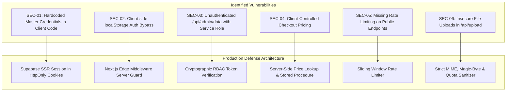

# ARONYOK (আরণ্যক) — Enterprise Security Architecture & Threat Mitigation Guide
**Security Baseline:** OWASP Top 10 | CIS Benchmark | GDPR & National Consumer Protection Principles  
**Status:** Mandatory Implementation Standard  
**Lead Architect:** Software Architecture & Engineering Agent  

---

## 1. Threat Modeling & Vulnerability Findings

During our security audit of the current codebase, seven critical and high-severity security vulnerabilities were identified. Each must be remediated prior to processing live commercial transactions.



### 1.1 SEC-01 & SEC-02: Client-Side Auth Bypass & Hardcoded Credentials
* **Finding:** In `src/app/admin/login/page.tsx`, the master credentials `hasan@aronyok.com` / `AronyokAdmin#2026` are bundled in plain text in client JavaScript. Additionally, `src/app/admin/layout.tsx` validates authentication by checking `localStorage.getItem("aronyok_admin_auth") === "true"`.
* **Exploitation:** Any external user can inspect source maps or open browser DevTools and execute `localStorage.setItem("aronyok_admin_auth", "true")` to gain full administrative UI access.
* **Remediation:** Remove all hardcoded credentials immediately. Migrate to Supabase Auth with secure, cryptographically signed `sb-access-token` and `sb-refresh-token` stored in `httpOnly`, `SameSite=Lax`, `Secure` cookies.

### 1.2 SEC-03: Privilege Escalation via Unauthenticated Administrative Endpoints
* **Finding:** `/api/admin/data` and `/api/admin/git-sync` accept requests from any IP without inspecting Bearer tokens or session cookies. Internally, `/api/admin/data` instantiates `getServerSupabase()` using `SUPABASE_SERVICE_ROLE_KEY`.
* **Exploitation:** An unauthenticated attacker can execute:
  ```bash
  curl "https://aronyok.vercel.app/api/admin/data?entity=orders"
  ```
  This immediately dumps all customer records, full home addresses, phone numbers, and payment details.
* **Remediation:** Enforce server-side session checks in all administrative API handlers. Reject any request lacking a verified Supabase session with `role IN ('super_admin', 'store_manager')`.

### 1.3 SEC-04: Arbitrary Price Tampering & Cart Injection in `/api/checkout`
* **Finding:** The checkout endpoint trusts the client-provided `price` and `total_amount` attributes sent in the JSON payload and commits them directly to the `orders` and `order_items` database tables.
* **Exploitation:** An attacker intercepting the checkout payload can modify a ৳2,500 tree seedling price to `price: 10` and `total_amount: 10`. The system accepts the order at ৳10.
* **Remediation:** Treat all client cart items as untrusted IDs and quantities only (`[{ product_id: "...", quantity: 2 }]`). The server must query the actual product prices from PostgreSQL, verify stock, calculate subtotal and delivery charges, and reject any mismatched request.

### 1.4 SEC-05: Missing Rate Limiting & Denial-of-Wallet Risk
* **Finding:** `/api/chat` connects to OpenRouter LLM without rate limiting or IP throttling. `/api/checkout` allows rapid-fire order generation.
* **Exploitation:** Automated bots can issue thousands of requests per minute, exhausting OpenRouter API credits and flooding the database with fake orders.
* **Remediation:** Deploy an in-memory or Redis-backed sliding window rate limiter allowing a maximum of 5 chat requests/min and 3 checkout attempts/min per IP.

---

## 2. Production Authentication & Authorization Blueprint

### 2.1 Next.js Edge Middleware (`middleware.ts`)
Edge Middleware intercepts all requests to `/admin/*` and `/api/admin/*` before rendering:

```typescript
// middleware.ts
import { createServerClient } from "@supabase/ssr";
import { NextResponse, type NextRequest } from "next/server";

export async function middleware(request: NextRequest) {
  let response = NextResponse.next({
    request: { headers: request.headers },
  });

  const pathname = request.nextUrl.pathname;

  // Only protect admin routes and admin APIs
  if (pathname.startsWith("/admin") || pathname.startsWith("/api/admin")) {
    if (pathname === "/admin/login") {
      return response; // Allow login page
    }

    const supabase = createServerClient(
      process.env.NEXT_PUBLIC_SUPABASE_URL!,
      process.env.NEXT_PUBLIC_SUPABASE_ANON_KEY!,
      {
        cookies: {
          getAll: () => request.cookies.getAll(),
          setAll: (cookiesToSet) => {
            cookiesToSet.forEach(({ name, value, options }) =>
              response.cookies.set(name, value, options)
            );
          },
        },
      }
    );

    const {
      data: { user },
      error,
    } = await supabase.auth.getUser();

    if (error || !user) {
      if (pathname.startsWith("/api/")) {
        return NextResponse.json({ error: "Unauthorized" }, { status: 401 });
      }
      const loginUrl = new URL("/admin/login", request.url);
      loginUrl.searchParams.set("redirect", pathname);
      return NextResponse.redirect(loginUrl);
    }

    // Verify staff role in profiles table
    const { data: profile } = await supabase
      .from("profiles")
      .select("role")
      .eq("id", user.id)
      .single();

    const allowedRoles = ["super_admin", "store_manager", "fulfillment_agent"];
    if (!profile || !allowedRoles.includes(profile.role)) {
      if (pathname.startsWith("/api/")) {
        return NextResponse.json({ error: "Forbidden: Insufficient privileges" }, { status: 403 });
      }
      return NextResponse.redirect(new URL("/admin/login?error=unauthorized", request.url));
    }
  }

  return response;
}

export const config = {
  matcher: ["/admin/:path*", "/api/admin/:path*"],
};
```

---

## 3. Server-Side Administrative Session Guard

In every `/api/admin/*` route handler, enforce the authenticated staff check:

```typescript
// src/lib/auth/admin-guard.ts
import { NextRequest } from "next/server";
import { createServerClient } from "@supabase/ssr";

export interface AuthenticatedStaff {
  userId: string;
  email: string;
  role: string;
}

export async function verifyAdminSession(req: NextRequest): Promise<AuthenticatedStaff | null> {
  const supabase = createServerClient(
    process.env.NEXT_PUBLIC_SUPABASE_URL!,
    process.env.NEXT_PUBLIC_SUPABASE_ANON_KEY!,
    {
      cookies: {
        getAll: () => req.cookies.getAll(),
        setAll: () => {},
      },
    }
  );

  const { data: { user }, error } = await supabase.auth.getUser();
  if (error || !user) return null;

  const { data: profile } = await supabase
    .from("profiles")
    .select("role, is_active")
    .eq("id", user.id)
    .single();

  if (!profile || !profile.is_active) return null;
  if (!["super_admin", "store_manager", "fulfillment_agent"].includes(profile.role)) {
    return null;
  }

  return {
    userId: user.id,
    email: user.email || "",
    role: profile.role,
  };
}
```

---

## 4. Payment Gateway Webhook Verification

### 4.1 bKash Webhook Security
* Verify the RSA-SHA256 signature using the bKash public key passed in the `x-signature` header.
* Re-query the bKash Query Payment API (`/tokenized/checkout/payment/status`) server-to-server to confirm payment validity before marking an order as `paid`.

### 4.2 SSLCommerz IPN (Instant Payment Notification)
* Validate IPN requests by calling the SSLCommerz Order Validation API with the transaction `val_id`.
* Compare the validated currency (`BDT`) and amount with the database order total before changing the order state.

### 4.3 Stripe Webhooks
* Construct and verify the webhook event using `stripe.webhooks.constructEvent(payload, sig, endpointSecret)`.
* Only handle `payment_intent.succeeded` and `checkout.session.completed`.

---

## 5. File Upload Security (`/api/upload`)

1. **MIME Type & Magic Byte Validation:** Never trust client `file.type`. Verify the magic bytes of incoming images (`FF D8 FF` for JPEG, `89 50 4E 47` for PNG, `52 49 46 46` for WebP).
2. **File Size Quota:** Enforce a strict 5MB maximum file size limit.
3. **Storage Sanitization:** Generate random UUID filenames (`${crypto.randomUUID()}.webp`). Never preserve user-supplied original filenames.
4. **Isolated Storage:** Store all product assets in Supabase Storage buckets with strict Content Security Policy (CSP) headers preventing script execution.

---

## 6. Audit Logging & Non-Repudiation

Every administrative action that modifies prices, creates stock movements, updates order statuses, or cancels shipments must record an entry in `public.audit_logs`:
* Timestamp (UTC)
* Operator ID and Email
* Action Code (`UPDATE_PRODUCT_PRICE`, `DISPATCH_SHIPMENT`, `CANCEL_ORDER`)
* Target Table and Row ID
* JSON Diff (`{ before: { price: 500 }, after: { price: 650 } }`)
* Remote IP Address and User-Agent
